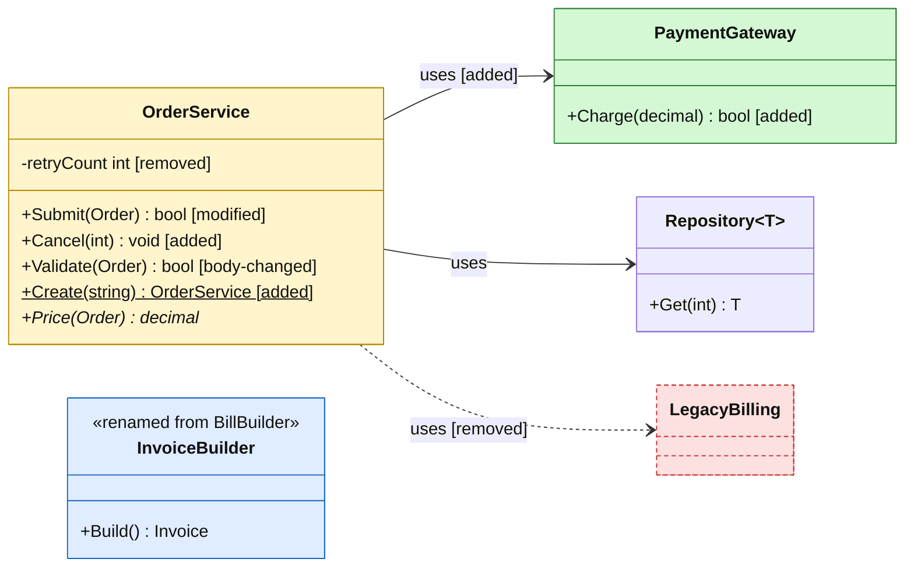

# Spike S1: Mermaid in Azure DevOps PR comments

Closes open item O3 in [../requirements/requirements.md](../requirements/requirements.md)
and fixes the member-tag format for R20. The test is manual: the PO posts the sample on a
scratch PR in the target organisation. Nothing in this repository posts anything.

The sample below is synthetic. It uses no target names, so it can live in this public
repository and can be pasted anywhere.

## What the sample exercises

| Feature | Where in the sample | Why it matters |
|---|---|---|
| `classDef` per type state | `added`, `removed`, `modified`, `renamed`, `context` | The colouring scheme (R20) depends on it. Needs Mermaid 10 or later |
| `:::state` on a class | every class | How the renderer attaches a state |
| Trailing member tag `[state]` | `+Cancel(int) void [added]` | Leading `+ - # ~` are visibility syntax, so the state goes at the end |
| Tag after a static `$` or abstract `*` classifier | `+Create(string)$ OrderService [added]` | The classifier must keep working with a tag present |
| `body-changed` tag | `+Validate(Order) bool [body-changed]` | R13's extra member state |
| Generic type `~T~` on a context node | `Repository~T~` | `~T~` is generics syntax, so it must not be read as a tag |
| Stereotype for rename provenance | `<<renamed from BillBuilder>>` | Candidate way to show the old name (R14) |
| Edge labels with a state | `uses [added]`, dotted `uses [removed]` | Edge diff (R13) |

Mermaid Chart's own renderer draws all of these correctly (checked 2026-11-16): static
members stay underlined and abstract ones italic with the tag present, and `~T~` renders
as `<T>`. Azure DevOps is the unknown.

## Sample (paste including the fence)

````markdown

````

**Expected if supported:** five boxes. Yellow `OrderService` with six members, green
`PaymentGateway`, dashed red `LegacyBilling`, blue `InvoiceBuilder` with a
«renamed from BillBuilder» stereotype, grey `Repository<T>`. Three arrows, one dotted.

## Steps

1. Create a throwaway branch with a one-line change. Open it as a **draft** PR against a
   throwaway target branch, so the PR pipeline does not run.
2. On the PR's Overview tab, add a new top-level comment, paste the sample including the
   fence, and click Comment.
3. Record whether it renders as a diagram, as a code block, or as plain text. Repeat the
   paste in:
   1. the PR description;
   2. an inline comment on a file;
   3. the same top-level comment after editing it (the sticky thread is updated in place,
      R24, so an edited comment must still render);
   4. a notification preview (email, Teams or mobile), if reviewers rely on one.
4. As a baseline, open the same Markdown as a file in Repos (file preview supports
   ```` ```mermaid ````) and in a Wiki page (Wiki uses `::: mermaid`).
5. Record the Azure DevOps version (Services, or the Server version from the About page)
   and the browser.
6. If it renders as a code block, test the PNG fallback (R21): upload a PNG with
   `POST .../pullRequests/{id}/attachments/diagram.png?api-version=7.1` (body is the bytes,
   `Content-Type: application/octet-stream`), and embed it as ``.
   Note whether the pipeline's job token is allowed to upload.

## Reading the result

| Observation | Decision |
|---|---|
| Diagram renders, colours apply, tags readable | O3 closed. Mermaid is the default renderer. Tag format `[state]` adopted |
| Boxes draw but no colours | Renderer older than Mermaid 10. Mermaid default is unusable for state; PNG default |
| Code block or plain text | PNG default (R21). Check the attachment upload in step 6 |
| Renders in the description but not in comments | PNG for the thread. Record it, because R24 posts a thread |
| A specific feature breaks (classifier, `~T~`, stereotype, edge label) | Keep Mermaid, drop that feature from the renderer, record which |

## Result

Fill in after running. Keep the record free of target names (D15): the org, project and
PR number stay out of this file.

- Date:
- Azure DevOps version / browser:
- Top-level comment:
- Description:
- Inline comment:
- Edited comment:
- Notification preview:
- PNG attachment with job token:
- Decision (renderer default, tag format):
